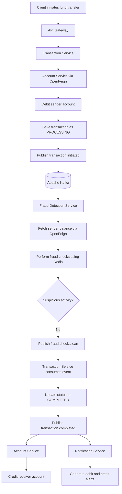
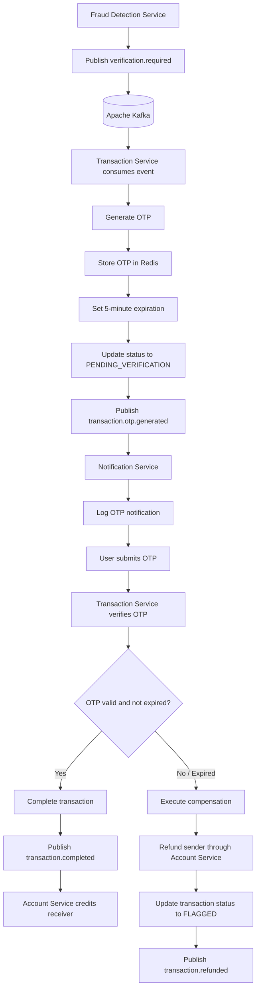
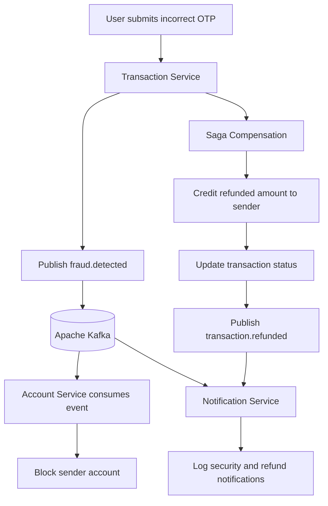

# Banking Transaction Flow – Saga Pattern

This diagram illustrates the end-to-end fund transfer workflow, including asynchronous fraud detection, OTP verification, transaction completion, and compensating actions.

## 1. Successful Transaction Flow

## 2. Suspicious Transaction – OTP Verification

## 3. Failed Verification – Account Blocking

## Saga Workflow Summary

| Stage | Action | Service |
|---|---|---|
| 1 | Initiate transfer | Transaction Service |
| 2 | Debit sender | Account Service |
| 3 | Publish transaction event | Transaction Service |
| 4 | Evaluate transaction risk | Fraud Detection Service |
| 5 | Request OTP if suspicious | Fraud Detection Service |
| 6 | Generate and store OTP | Transaction Service + Redis |
| 7 | Complete or compensate | Transaction Service |
| 8 | Credit receiver or refund sender | Account Service |
| 9 | Process notifications | Notification Service |

**Key Design Concepts**

- Event-driven communication using Apache Kafka.
- Saga-style distributed transaction processing.
- Redis-based fraud detection and temporary OTP storage.
- Synchronous inter-service communication using OpenFeign.
- Compensating transactions for failed verification.
- Asynchronous account updates and notification processing.
